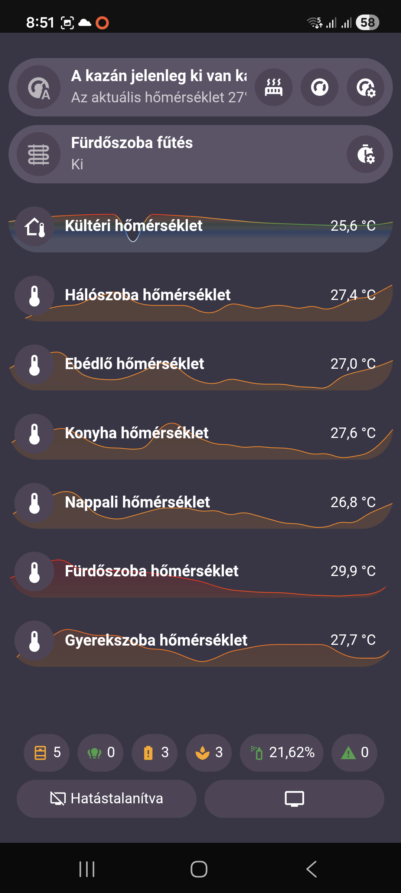
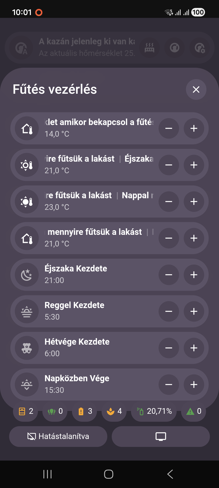

A fűtés vezérlés immár egy automatizmus oldja meg [Fűtés Blueprint](https://gist.github.com/MackoMici/c127d5eb877dab4dc0cf1c1341f57763), mely úgy lett kitalálta vagy minden változót tudjak a felületről változtatni, így nem kell az automatizmust állandóan szerkeszteni.

|  |  |
|:---:|:---:|