A mobil kinézet kialakításánál az volt a lényeg, hogy minden információ az adott témában külön oldalt kapjon és az lehetőleg 1 képernyőre kiférjen (ez utóbbi lehetetlen) a felső sáv mindenkinél el van tüntetve [browser_mod](https://github.com/thomasloven/hass-browser_mod)-dal mivel az oldalakat a [Swipe Navigáció](https://github.com/zanna-37/hass-swipe-navigation)-val könnyen oldalra húzással lehet lapozni. Minden oldal külön _yaml_ fájlban van írva, hogy a tablet nézetnél is fel lehessen használni illetve a felületen nem kelljen ugyanazt a kódot használni többször.

| 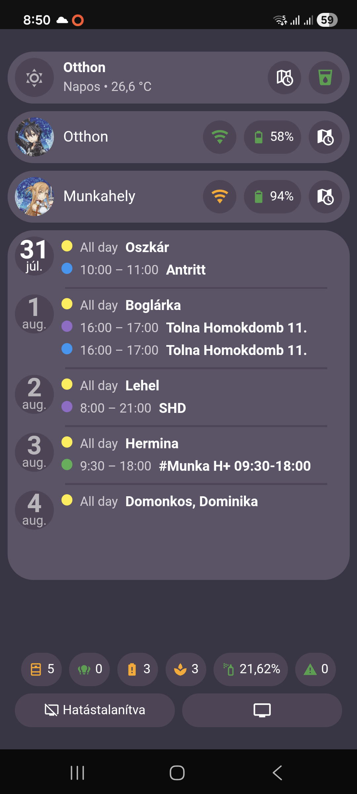 | Kezdőlap: minden oldalon alul található egy gombsor amivel röngtön el lehet érni a számomra kiemelt funkciókat vagy pop-up ablakban vagy az adott oldalra ugrással (pl: nyitott ablakok, világítás, merülő elemek, riasztások kezelése). Felül pedig az időjárás látható mely különböző gombokat tartalmaz így alár szöveges, radar vagy előrejelzést is meg tud mutatni. Majd látható a felhasználók információja. Végül következik a naptár ahol a közelgő események jelennek meg. |
|:---:|:---:|
| 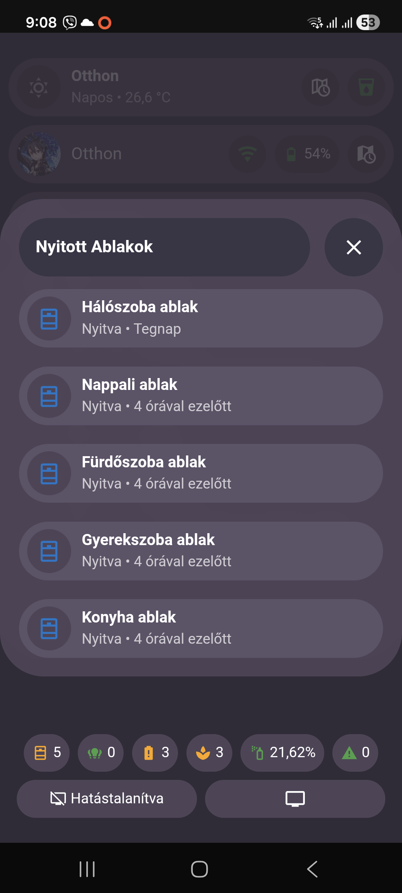 | Így néznek ki a felugró ablakok az oldalakon. |
| 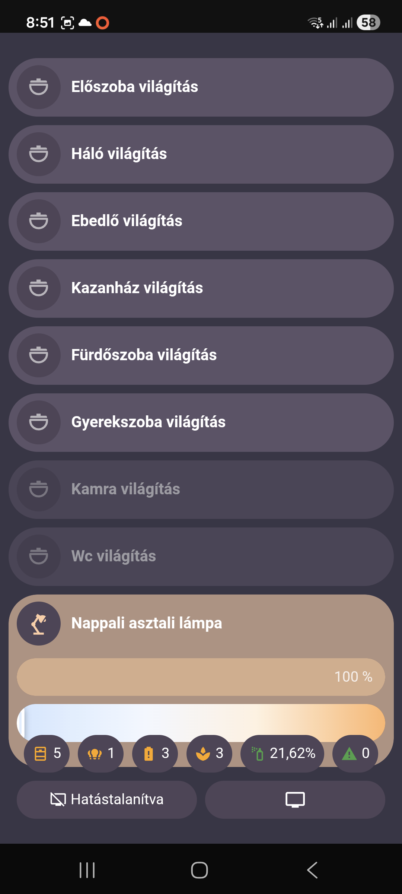 | Világítás oldal: itt jelenleg csak a világítással kapcsolatos dolgokat lehet vezérelni vagy csak ki/be kapcsolás ha viszont vannak extra funkciók akkor azok is megjelennek és így külön lehet a színt telítetséget állítani. [Világítás template](/lovelace/streamline_templates.yaml#L117-L211) |
| 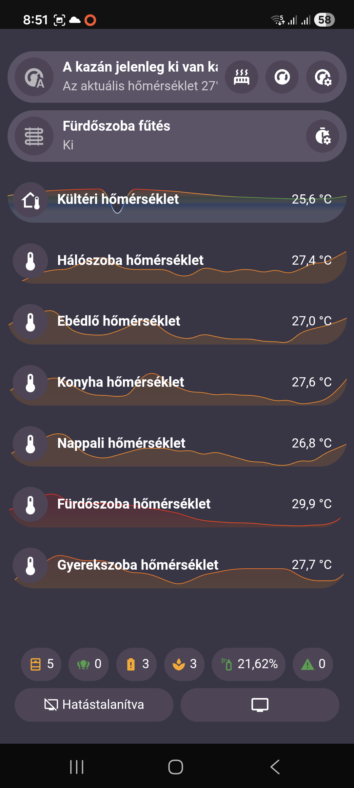 | Automatizmus vezérli a fűtéset ezen az oldalon lehet extra funkciókat elérni úgy mint az automatizmus változóinak beállítása, fűttés mindenképp. A fürdőszoba fűtés is itt foglal helyet amit kézzel lehet bekapcsolni viszont az időzített kikapcsolásról [automatizmus](https://gist.github.com/MackoMici/21fba72a2ef0343f793535a01293727c) gondoskodik. Valamint az elműlt 24 óra hőmérsékleteit lehet látni grafikonon. |
| 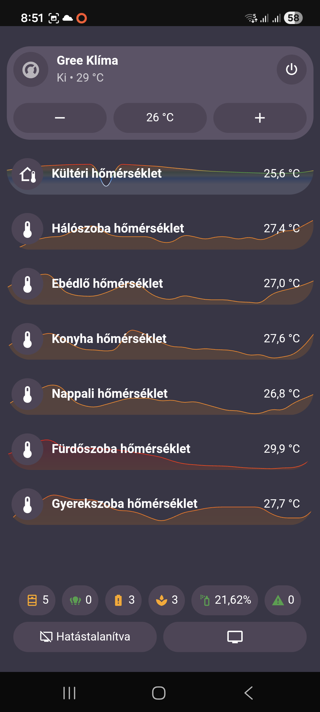 | Klíma vezérlés semmi extra de csak akkor jeelnek meg a funkció gombok ha a klíma be van kapcsolva, annyi extrát kapott, hogy minden funkció másik háttérszín kapott így könyebb tudni milyen funkció van bekapcsolva. |
| 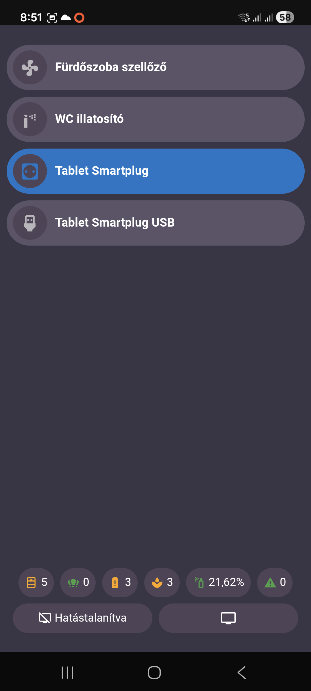| Kapcsolók amik nem a világítást vezérlik, szinte sose kell használni őket, mert mindegyikre van automatizmus. |
| 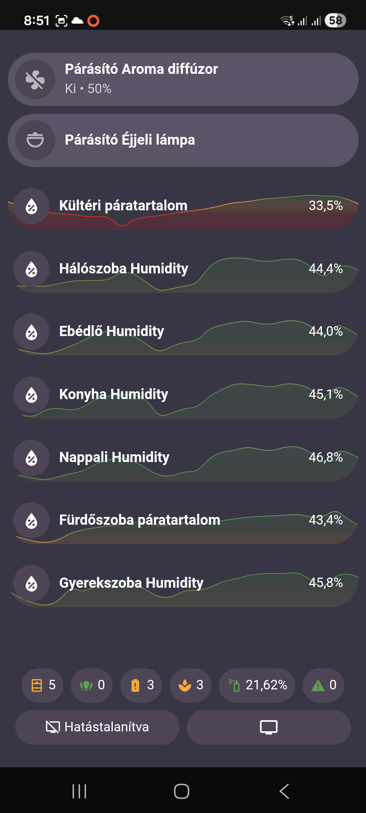 | A párásítónál értelemszerűen a párásítást lehet bekapcsolni és az ő világítását vezérelni, itt a szobák páratartalma jelenik meg az elműlt 24 órából- |
| 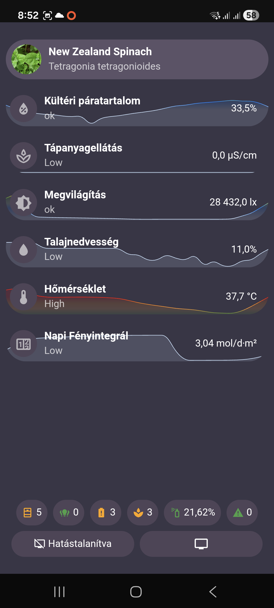 | A növény kártya is tartalmaz grafikont az elműlt 24 óra adataival. |
| 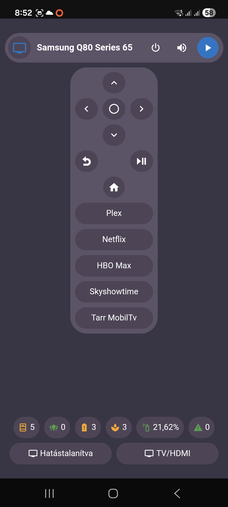 | A TV kártya kapott egy kis távirányítót ha be van kapcsolva a készülék így akár innét is lehet vezérlni mindent a tv-vel kapcsoltban. |
|  | A tabletről mutat hasznos információkat valamint kamera képet lehet látni ha a mozgás érzékelés ba van kapcsolva. Emellett még van egy Joan6-os kijelző amin óránkét frissül az időjátás előrejelzés, ennek az információit lehet látni. |
| 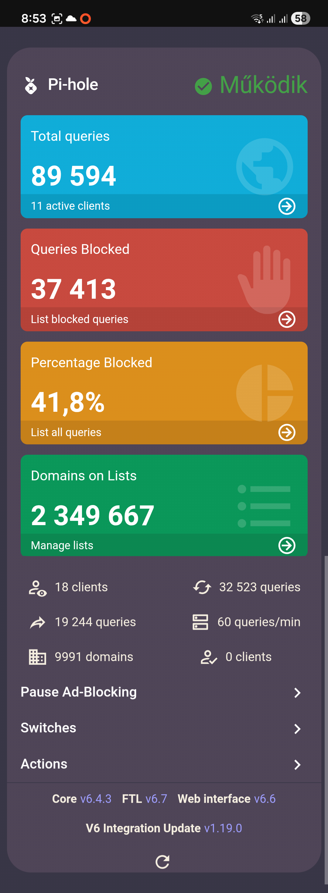 | Mivel meguntan a sok reklámot az oldalak alatt így saját pi-hole szervert is indítottam így azért sokkal kellemesebb a netezés itthon minden készüléken, ennek az információit láthatjuk az adott lapon. |
| 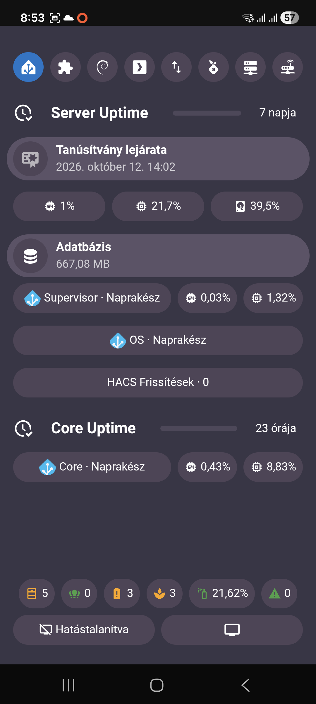 | Ezen az oldalon elég sok infónak kellene megjelenjen és yg nem férne el egy oldalra, így minden különálló egységet a fent elhelyezett gombsor aktivál. A CPU, memória és társaik gombnyomásra megnyitnak egy grafikont ahol a korábbi adatokat nézhetjük meg grafikon alapján. Ez a funkció a Tablet infóknál is működik. |
| 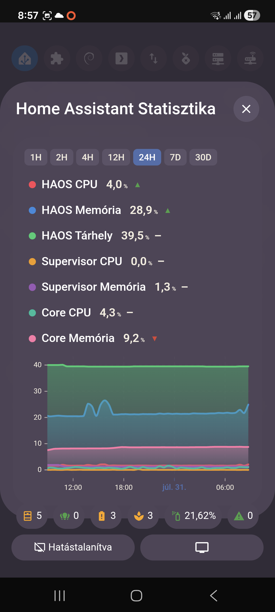 | 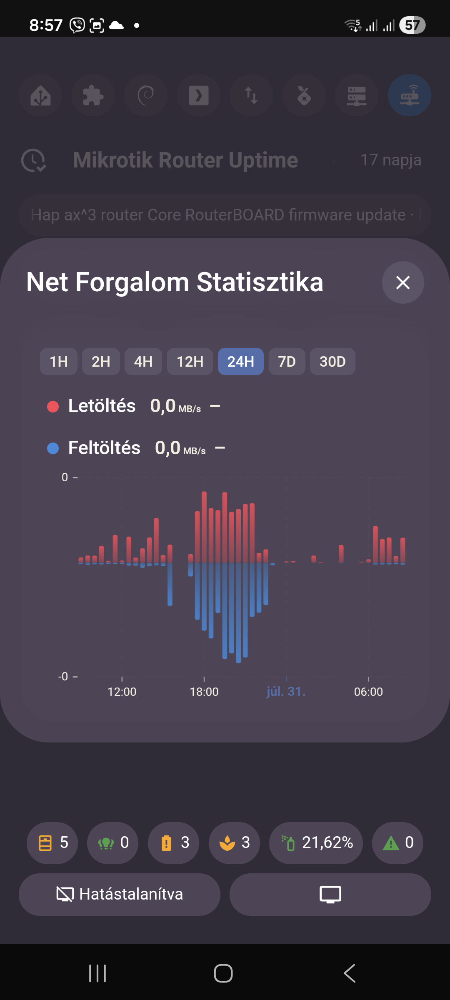 |

